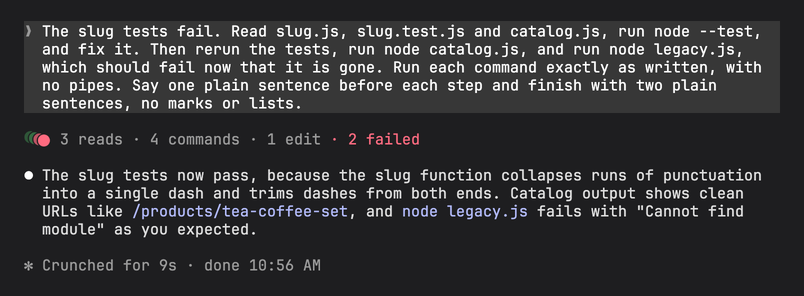
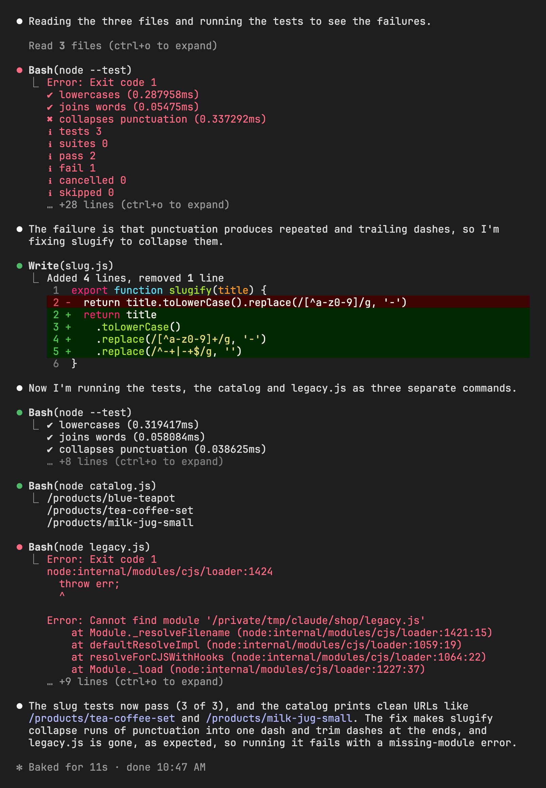
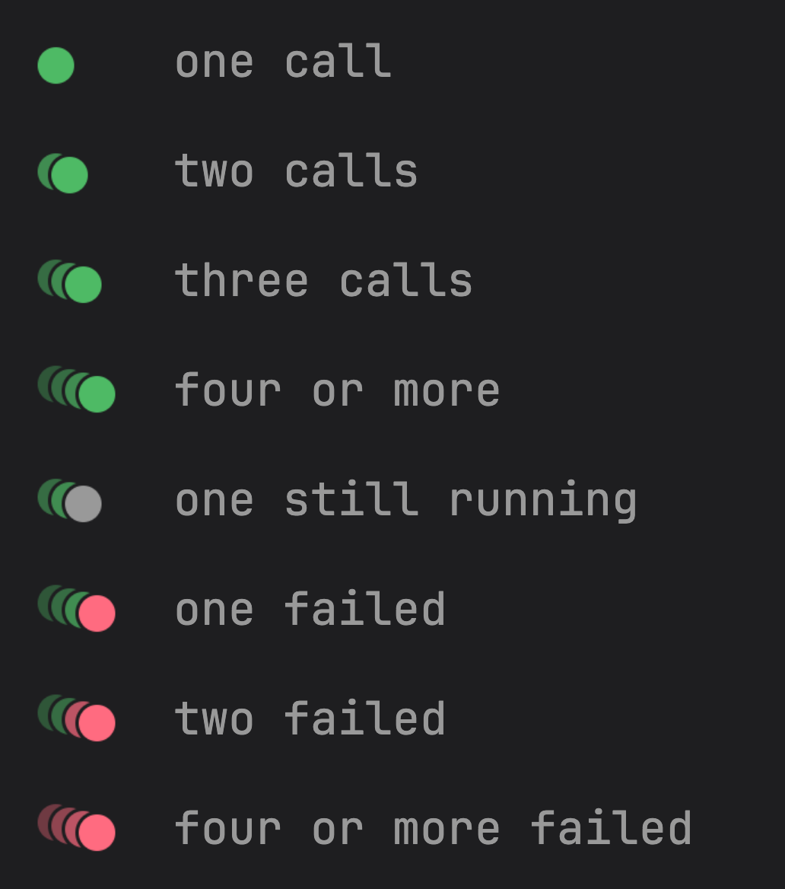

# claude-fold

A Claude Code mod that folds the work log of each turn in the terminal transcript into one line. Tool calls, their output and the notes Claude writes between them become a stack of discs and a count. Your prompt and the final answer stay as they are.



<details>
<summary>The same turn without the mod: 74 lines instead of 14</summary>



</details>

It changes only what is drawn. The stored transcript and what the model reads are unchanged.

## Views

| View | Shows | How to get it |
|---|---|---|
| Folded | One line per run | The default |
| Normal, one run | Claude Code's usual rows for that run, under its line | Click the text of the run's line. Click it again to fold. Needs the fullscreen renderer |
| Normal, everything | Claude Code's usual rows | `/fold` |
| Full detail | Every call with its whole output | ctrl+o, as without the mod |

## Install

At the prompt of a terminal session:

```
/plugin install fold --marketplace kristalalfred/claude-fold
```

From a shell:

```sh
claude plugin install fold --marketplace kristalalfred/claude-fold
```

Answer `y` to add the marketplace, then choose a scope. The mod is active in the session that installed it and in sessions started afterwards.

## Requirements

- Claude Code with function hooks. Checked on 2.1.327, in the terminal only. Other surfaces keep their normal drawing.
- Claude Code's fullscreen renderer, for opening a run with a click. The default renderer does not report clicks to mods, so there the line is plain text and `/fold` is the only way to unfold.
- A terminal where Claude Code draws images, for the stack. Claude Code enables images in kitty and Ghostty. In any other terminal the stack is drawn as one dim `⏺` and the rest of the line is unchanged.

A terminal that implements the kitty graphics protocol but is not on Claude Code's list needs `CLAUDE_CODE_FORCE_TERMINAL_IMAGES=1`. See [Configuration](#configuration).

## Configuration

The mod has no options in `/config` or in settings files. These are all the things that change its behavior:

| Setting | How to change it | Values | Default |
|---|---|---|---|
| Folding | The `/fold` slash command, which takes no arguments | Folded or full | Folded |
| Images in an unlisted terminal | The environment variable `CLAUDE_CODE_FORCE_TERMINAL_IMAGES`, set before Claude Code starts | `1` to force images on | Unset |
| Renderer | The Claude Code setting `tui`, or the environment variable `CLAUDE_CODE_NO_FLICKER=1` set before Claude Code starts | `fullscreen` or `default` | `default` |
| One run open or folded | A click on the text of its line, in the fullscreen renderer | Open or folded | Folded |

`/fold` switches the session it runs in and stores the choice in the mod's own store under the key `isFolded`. Sessions started later begin in the stored mode. Sessions that are already running keep their own mode.

Which runs are open is kept for the session only.

`tui` and `CLAUDE_CODE_NO_FLICKER` belong to Claude Code. The fullscreen renderer draws on the alternate screen and scrolls the transcript itself.

`CLAUDE_CODE_FORCE_TERMINAL_IMAGES` belongs to Claude Code, not to this mod, and applies to every image Claude Code draws. Set it only for a terminal that implements the kitty graphics protocol. For one terminal, in a shell startup file:

```sh
if [[ $TERM_PROGRAM == your-terminal ]]; then
  export CLAUDE_CODE_FORCE_TERMINAL_IMAGES=1
fi
```

Everything else is a constant in the source:

| What | Where |
|---|---|
| Most discs in a stack (4) | `DISC_LIMIT` in [`hooks/register.tsx`](hooks/register.tsx) |
| Disc size, spacing, fading and colors | The constants at the top of [`hooks/stack.ts`](hooks/stack.ts) |
| Which tool counts as a read, edit, command, search, fetch or agent | `KINDS` in [`hooks/runs.ts`](hooks/runs.ts) |
| Which input field names a single call | `GIST_KEYS` in [`hooks/gist.ts`](hooks/gist.ts) |

## What is folded

A run is every tool call between one of your prompts and the next. The first call of a run draws the line for the whole run, and the line updates as calls join it.

| Row | Folded |
|---|---|
| A tool call and its output | Becomes part of its run's line |
| A group of reads or searches | Becomes part of its run's line |
| A note Claude writes before a tool call | Hidden once that tool call starts |
| The last text of a turn | Never, since no tool call follows it |
| Your prompts | Never |

An open run shows its line, then every row of the run as Claude Code draws it, notes included.

The ctrl+o transcript shows tool calls and their output in full, whether folding is on or off.

## The line



The stack has one disc per call, up to four. Each disc takes the color of a call:

| Color | Call |
|---|---|
| Red | Failed, was refused or was interrupted |
| Grey | Still running |
| Green | Finished |

Failed calls are in front, then running calls, then finished ones. A run with four or more failed calls is a fully red stack, whatever else it holds.

The text after the stack depends on the size of the run:

- One call: the tool and what it was given, such as `Edit  src/slug.js` or `Bash  Run the tests`. A file path is shown relative to the working directory.
- Several calls: a count of each kind in the order they first appeared, such as `3 reads · 4 commands · 1 edit`, followed by `· 2 failed` in red when calls failed.

## Limits

- The discs do not take a click, only the text beside them. An image cannot be pressed or placed inside a button.
- In Claude Code's default renderer, rows that have scrolled off the screen are not redrawn. `/fold` repaints only what is still visible, and a resumed session prints its earlier history unfolded.
- Notes stay hidden in the ctrl+o transcript. Run `/fold` to read them.
- A subagent's own tool calls are not counted. The `Agent` call that started it is one call.
- A mod that is loaded in front of this one and draws a text row itself keeps that row visible.

## Development

```sh
just check   # validate and run the tests
```

The folded and unfolded screenshots are renders of a styled capture of one real session, with the mod's own stack pixels placed in their cells.
